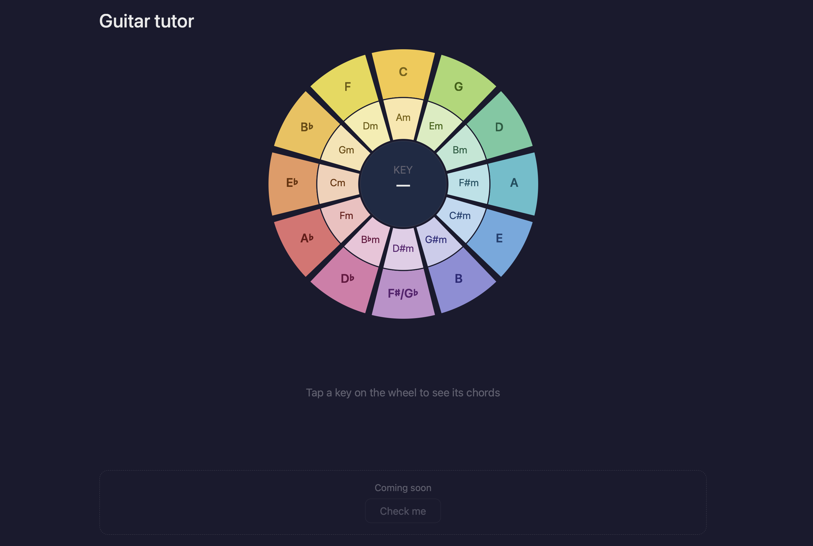
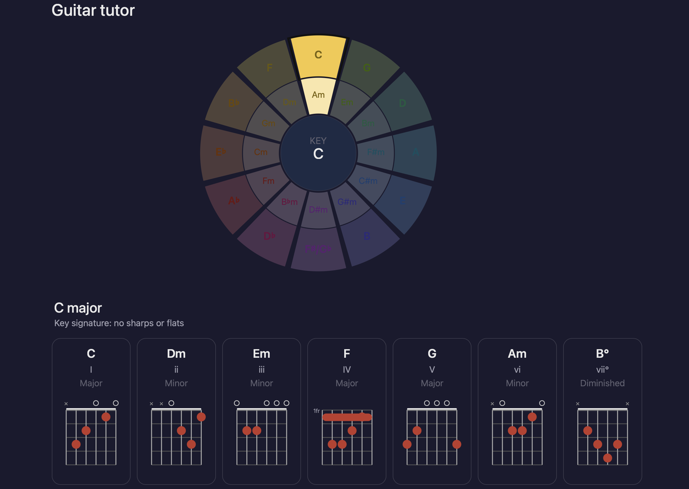

<p align="center">
  
</p>

# Guitar Tutor
A web app for guitarists to explore keys, chords, and fingerings using the circle of fifths. 

Built as a Progressive Web App (PWA), it runs in the browser and can be installed directly on an iPad or iPhone from Safari.

## What it does
- Circle of fifths: tap any key on the wheel to select it
- Chord display: shows all 7 chords in that key with their scale degree (I, ii, iii, IV, V, vi, vii°) and type (Major, Minor, Diminished)
- Fingering diagrams: each chord shows a guitar fretboard diagram with dot positions, open strings, and muted strings. Barre chords show the fret number
- Check Me (*coming soon*): tap a chord, play it on your guitar, and the app will listen and tell you if you played it correctly





## How to use it
### In a browser
Visit the app at:
https://mdbromhal.github.io/guitar_tutor/ 

### Install on an iPad or iPhone
1. Open the link above in **Safari**
2. Tap the **Share** button at the bottom of the screen
3. Tap **Add to Home Screen**
4. Tap **Add** and the app will appear on your home screen like a regular app

### Reading a chord diagram
```
  ✕  ○           ← ✕ = mute this string, ○ = play it open
  |  |  |  |  |  |
  ╔══════════════╗  ← thick bar = nut (open position)
  ║  ●  ●  |  |  ║
  ║  |  |  ●  |  ║  ← ● = place your finger here
  ║  |  |  |  |  ║
  ╚══════════════╝
  E  A  D  G  B  e  ← strings, low to high
```
For barre chords, a number on the left (like ```2fr```) tells you which fret to position your index finger across all strings.

### Coming soon
- Check Me: play a chord into your device microphone and get instant feedback on whether you played it correctly
- Alternate chord voicings
- Minor key support

## Feedback
If something looks wrong or you'd like a feature added, get in touch directly!

## Developer Notes
### Project Structure
```
guitar_tutor/
├── .github/
│   └── workflows/
│       ├── deploy.yml
│       └── lint.yml
├── public/
│   ├── icon-192.png
│   ├── icon-512.png
│   ├── manifest.json
│   └── sw.js
├── src/
│   ├── components/
│   │   ├── CheckMe.jsx
│   │   ├── ChordDiagram.jsx
│   │   ├── ChordGrid.jsx
│   │   └── CircleOfFifths.jsx
│   ├── data/
│   │   └── chords.json
│   ├── hooks/
│   │   ├── useChordAudio.js
│   │   └── useSelectedKey.js
│   ├── utils/
│   │   ├── chordUtils.js
│   │   └── musicTheory.js
│   ├── App.css
│   ├── App.jsx
│   └── main.jsx
├── .gitignore
├── index.html
├── package.json
├── README.md
└── vite.config.js
```

### Tech stack

- **React 18** + **Vite 5** — UI framework and build tool
- **vite-plugin-pwa** — generates service worker and PWA assets
- **ESLint 9** — linting with React hooks rules
- No other dependencies — chord diagrams are drawn as SVG, no charting library needed

### Running locally

```bash
npm install
npm run dev
```

Open `http://localhost:5173` in your browser. To test on a phone or tablet on the same WiFi:

```bash
npm run dev -- --host
```

Vite will show a network URL like `http://192.168.x.x:5173` — open that on your device in Safari.

### Deployment

Pushes to `main` trigger two GitHub Actions:

- **lint.yml** — runs ESLint on every push and pull request
- **deploy.yml** — builds the app and deploys to GitHub Pages

Live URL: `https://mdbromhal.github.io/guitar_tutor/`

### Adding or editing chords

All fingerings live in `src/data/chords.json`. Each entry looks like:

```json
"Dm": {
  "strings": ["x", "x", "0", "2", "3", "1"],
  "barre": null
}
```

`strings` is an array of 6 values — low E to high E. Values are `"x"` (mute), `"0"` (open), or a fret number. `barre` is the fret number for barre chords, or `null`.

### Adding the Check Me feature

The stubs are already in place:

- `src/hooks/useChordAudio.js` — add Web Audio API + pitch detection here
- `src/components/CheckMe.jsx` — wire up the UI here

Recommended library: [`pitchy`](https://github.com/ianprime0509/pitchy) for pitch detection, or [`chord-detector`](https://github.com/cstb/chord-detector) for full chord detection from microphone input.